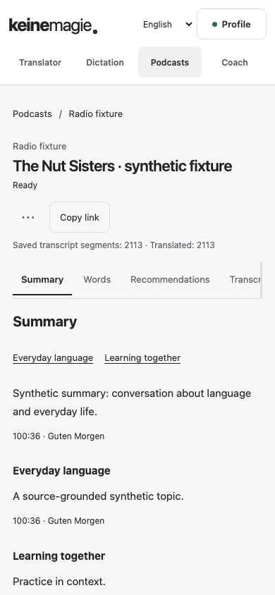
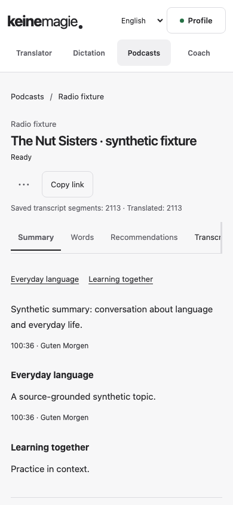
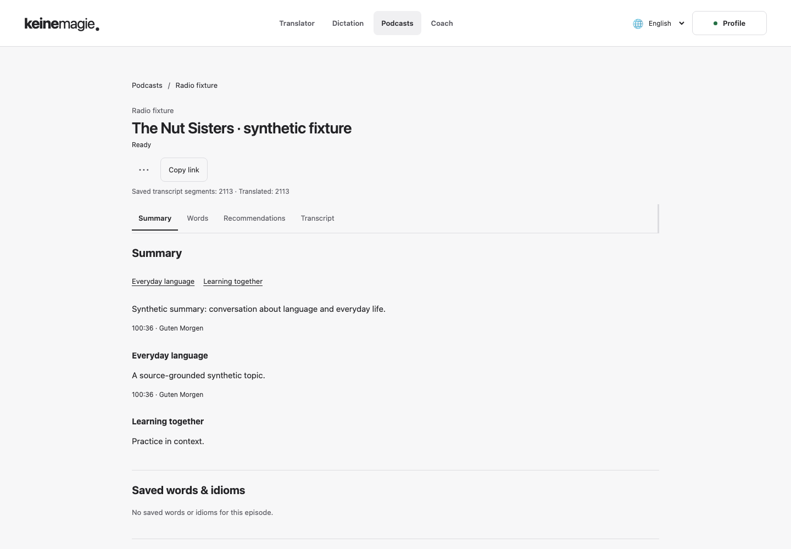
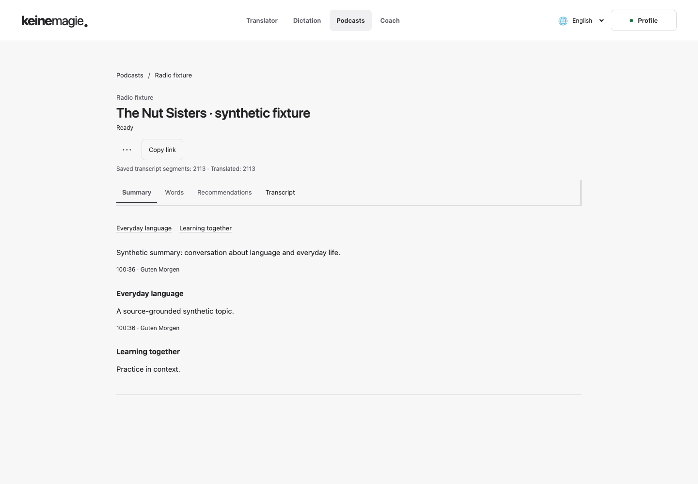

# Episode true tabs (web)

## Source and scope

- Isolated worktree: `/Users/tinyserve/Projects/KeineMagie-episode-true-tabs`, branch `fix/episode-true-tabs`.
- Freshly fetched `origin/main`: `5d532e9118193874175f9d9b339d7e6e3ec1a8c6`.
- Requested source: `f787b40e044ddd44b62c5557a1a7a7e78443425c`. The difference to the fetched base is only `docs/NATIVE-PODCAST-OVERVIEW.md`; web source is identical.
- Production changes: `web/episode-view.mjs`, `web/episode.css`, one route predicate in `web/episode.mjs`, seven lines in `web/app.mjs` (legacy-fragment normalization and optional reader route lifecycle notification).
- No backend, native, Coach, Translator, passage-star behavior, analysis algorithm, API payload, quota or request-budget changes. Coordinate these four production files at integration; do not overwrite another worktree. At the initial candidate handoff no push/deployment had been performed; the authorized release is recorded below.

## State and accessibility contract

1. Summary, Words, Recommendations and Transcript are four button tabs in one named `tablist`. Each has a stable ID, `aria-controls`, `aria-selected`, and roving `tabindex`. Exactly one of four mounted `tabpanel` elements is visible. Inactive panels have `hidden`, `inert`, `aria-hidden=true`, and enforced `display:none`.
2. Activation is automatic for Left/Right (wrapping) and Home/End. Native button Enter/Space remains consistent. Tab exits the tablist through the selected tab; the selected panel is keyboard-focusable. Pointer tab activation does not programmatically focus a panel or scroll to a section heading. Keyboard focus remains visibly outlined; there is no global outline suppression.
3. Tab switching changes presentation attributes only: it does not call `draw`, fetch data, start generation, cancel generation, or replace editors. Search query, match index, timestamp value, open quote editors, draft text/selection and downloaded transcript data remain mounted. Status updates still reconcile the mounted DOM, including the inactive Summary panel.
4. The existing private episode path remains canonical. `?section=summary|vocabulary|recommendations|transcript` persists the active tab; existing `segment` and `topic` targets remain supported. Legacy `#episode-summary`, `#episode-vocabulary`, `#episode-recommendations`, `#episode-transcript` and unprefixed equivalents are normalized to the section query **before** application routing. `words` maps to the existing `vocabulary` route key. Global application hashes are unchanged.
5. Citation/time/search jumps activate Transcript, materialize only the target's existing 100-segment chunk when needed, then measure the visible layout and scroll/focus the target with measured sticky offsets. Invalid/out-of-range segment values do not materialize extra chunks or prevent the requested panel from opening.
6. Back/Forward restores the tab, scroll position, query, match index, timestamp and source focus for that history entry. Search match navigation snapshots the old index before advancing. A tab's pointer focus must not overwrite the departing entry's source focus. Both browser Back and the explicit citation return restore the exact source citation control, not a heading.
7. Private drafts/search snapshots live in an owner-scoped in-memory map, not history state, URLs or persistent storage. History holds an opaque entry token and episode identity only. Reload restores URL tab/segment/topic, not private unsaved drafts. A new episode or owner clears the map. Owner change/logout synchronously purges **all** panels, including hidden editors; late responses cannot restore old-owner content.
8. An already-authorized bounded Generate/Resume pipeline continues through internal tab changes and internal Back/Forward. An actual application-route leave, owner change, explicit cancel or document hiding still stops continuation; returning does not silently resume. This is not a generation rewrite. Existing request estimate/consent and runner bounds are unchanged.
9. The sticky header is horizontally scrollable on narrow screens and keeps the active tab in view. Existing measured search offsets remain. Redundant panel-level headings are omitted: the tab labels name the panels; Summary topic headings remain.

## Verification (local synthetic API, real Chromium)

No production credentials, private history, provider inference, TTS, deployment or native builds were used. Browser fixtures are explicitly synthetic, not fabricated production output.

Test-first failures were observed for: four real tabs (baseline had zero); Back search restoration; legacy fragment routing; internal Back cancelling the bounded pipeline; invalid segment keeping the wrong panel active; browser Back losing citation focus; previous search match index being overwritten. Each failed behavior was fixed and rerun. The inherited navigation test also caught destination-tab focus overwriting a departed segment's focus; that regression was fixed before final verification.

Commands from the worktree:

```sh
PY=/Users/tinyserve/.hermes/cache/scratch/km-web-incident-venv/bin/python
node --check web/app.mjs
node --check web/episode-view.mjs
node --check web/episode.mjs
node --test web/tests/*.test.mjs
for test in episode_tabs_browser episode_tabs_lifecycle_browser \
  episode_tabs_owner_browser episode_tabs_compat_browser episode_browser \
  episode_navigation_browser episode_review_browser i18n_http_browser \
  bootstrap_browser; do
  "$PY" "web/tests/$test.py" || exit 1
done
git diff --check
```

Use a Python environment with Playwright and installed Chromium on other machines. The absolute `PY` above is the actual environment used here.

| Test | Final observed result |
| --- | --- |
| Node test suite | 113 passed, 0 failed |
| `episode_tabs_browser.py` | PASS: four tabs / one visible panel; one unignored AX tabpanel; hidden descendants cannot focus; click/keyboard; no ordinary heading scroll; URL/reload/Back/Forward; exact citation origin; timestamp; invalid segment; previous/next match history; 2,113-segment full-data search; zero analysis POSTs |
| Locale/viewport matrix in tabs suite | de/en/ru/es/fr × 390/1440; no document overflow; sticky search target unobscured; 20 Summary/Transcript screenshots |
| `episode_tabs_lifecycle_browser.py` | PASS: exactly three synthetic authorized pipeline POSTs across tabs/internal Back; progress updates hidden Summary; draft/selection/time/query retained; no restart. Separate actual-route-leave run stops after one POST and does not resume on return; logout removes panels |
| `episode_tabs_owner_browser.py` | PASS: hidden old-owner transcript present before switch; synchronous purge; delayed owner-A analysis cannot replace owner-B content; logout leaves zero panels even after delayed owner-B response |
| `episode_tabs_compat_browser.py` | PASS: old HTML/new modules; old episode helper/new view; old view/new shell and CSS; old shell/new view. Old view remains a usable stacked progressive fallback rather than blank. Blocked reader import leaves shell/Translator usable |
| `episode_browser.py` (adapted visibility/selectors) | PASS: legacy job path canonicalization, cosmetic slug, all tabs, 1,000 source / 954 translated / 46 pending, explicit generation, citation, vocabulary/profile readback, clipboard, owner purge, responsive layout; zero page errors |
| `episode_navigation_browser.py` (adapted real tabs) | PASS: selected panel, measured offsets, segment 2012, focus/reload/Back/citation, profile readback and four responsive widths; zero generation, zero page errors |
| `episode_review_browser.py` (adapted real tabs) | PASS: 20 combinations (five locales × 320/390/768/1440), forced wrapped-nav offsets, locale draft/selection, invalid URL input, delayed owner/profile/logout responses, empty/error/literal-content states; zero page errors |
| `i18n_http_browser.py` | 24 checks passed, zero page errors |
| `bootstrap_browser.py` | PASS: localized shell remains visible with app module blocked; bootstrap failure fallback remains localized/locked/usable |

### Known baseline issue, not caused by this change

`redesign_browser.py` fails at line 14 (`#connection-notice` has no bounding box). The **same failure** was reproduced using a clean `git archive 5d532e9 web` baseline under `/Users/tinyserve/.hermes/cache/scratch/episode-tabs-baseline`. Its later reader waits were updated to wait for attached (intentionally hidden) profile controls, but the unrelated guest-notice assertion was not changed. Do not report this historical suite as passing.

### Evidence

The supplied screenshot showed anchor navigation above stacked Summary/Words/Recommendations/Transcript and a programmatically focused panel outline. Baseline captures below use the actual unmodified `5d532e9` web assets and the same synthetic 2,113-segment fixture. Final captures use the modified real UI, not a mock design. Both sets were visually inspected.

| Width | Before | After (Summary selected; other panels hidden) |
| --- | --- | --- |
| 390 |  |  |
| 1440 |  |  |

Full locale/Transcript runtime captures are in `/Users/tinyserve/.hermes/cache/scratch/episode-true-tabs-evidence/`. The test recreates them. A focused keyboard search input legitimately retains its focus ring; no whole-panel black heading box is produced by pointer tab navigation.

## Remaining integration limits

- This verifies local Chromium with synthetic HTTP/data and DOM/AX inspection, not a live authenticated provider or a screen-reader listening session. Safari/Firefox were not exercised.
- Cold reload intentionally does not persist private unsaved editor/search drafts. Internal tab changes preserve them; same-view Back/Forward restores search state. A different episode/owner clears private snapshots.
- Browser scroll position can naturally clamp when replacing a long panel with a shorter one; ordinary tabs no longer perform a heading jump. Deep-link and history navigation intentionally scroll to their targets.
- A cached old reader remains stacked until the newer reader is loaded, but does not break the shell. No shared module export was added, avoiding a new-old graph import mismatch.
- Independent integration review and explicitly authorized web release completed November 17, 2026; see the release record below. Parallel Coach, Translator and passage-group candidates remain local and were not integrated.

## Independent review and authorized release — November 17, 2026

- Reviewed the actual four-file production diff, including all seven `app.mjs` additions and the legacy-route predicate. No production correction was necessary. Fresh remote main was exactly `5d532e9118193874175f9d9b339d7e6e3ec1a8c6`; normal non-force fast-forward pushed **`ade5e02ff9217fdc1b38616633c039432d296b67`**, then remote ref was read back. Native podcast inline-three, history, Diktat and prior fixes remain ancestors/unmodified; no native upload was needed or dispatched.
- Independently reran **113 Node tests and all nine Chromium suites** listed above, all passed. Repeated the complete tabs suite in dark mode: five locales × 390/1440, one visible and one unignored AX panel, hidden/inert focus exclusion, keyboard, exact citation return, search/history and zero automatic analysis calls. Actual light/dark mobile/desktop captures were inspected; no material issue found in this scope. Narrow tab labels intentionally scroll horizontally, not the document.
- Server CI **44067837616**, job **133986034476**, exact source above: **success**; build and publish step successful for amd64/arm64. Existing action runtime/runner migration warnings only. Pulled and inspected ARM64 artifact **`sha256:9312ef2ad4d7114598a29ea8bdc696a040f09ddc9848c35e27627d0b73543e30`**, with exact OCI revision. Previous live image freshly verified as **`sha256:37117949ee22c96a13313919fca8e2b0ce87b32084c9b647d46c3e37774edb36`**. Extracted old/new executables have identical SHA256 **`fb26fc854b7afd970c52a83136c2c400fd23b3168e8b77aa4886f40a59059757`**: runtime binary unchanged.
- Used the established original Compose base plus durable `compose.translator.yml` workaround, not a new tinyserve deployment mechanism. Full merged config comparison proved backend image was the sole change. Nonblocking durable-store/account locks acquired and authoritative idle states rechecked before stopping only backend; lifetime runner flock acquired after stop, backup taken under locks, runner released immediately before replacement while store locks stayed held through final snapshot. No active job interrupted.
- Fresh locked before/after inventory: **30 actual nonruntime durable files byte-identical** (not the earlier release's 27); **one completed job, zero active, 2113 segments / 2113 translations**. Single existing November acceptance budget entry retained, **USD 1 reserved / 826 micro-USD reported / at most nine further attempts**. No retry, owner job mutation, paid provider or TTS call.
- Worker remains **`sha256:a61794a3d7e74b63d9626c453f3b0bac1b9f9f1351b0bb6349ccf564bded9382`**; worker and all unrelated container IDs unchanged. Exact environment, resources/security, mounts, routing labels and network membership preserved. Private network remains internal and backend/worker-only. Dedicated TTS volume read-only; key metadata **65532:65532 / 0400**, access permission verified after dropping UID/GID without reading the secret value; host source remains 0600.
- Public certificate-validated HTTPS: **health 200; session/podcasts/subscriptions/Coach/Dictation 401; source/env/secret/data probes 404**. **All 29 allowlisted runtime assets** match exact committed bytes, all public responses include `no-store`; full module graph checked, not only `app.mjs`. Actual public guest browser inspected desktop and mobile Podcasts: guest sign-in, no private panels, no document overflow.
- Full tabs browser suite rerun on **actual live HTTPS assets**, with every `/v1/**` request intercepted before bootstrap and routed only to the local synthetic fixture: passed five locales × two widths, AX/keyboard/history/legacy/search/citations and zero analysis POSTs. Separate lifecycle and owner-isolation suites passed using freshly downloaded, hash-verified live assets with loopback synthetic APIs: three authorized fixture steps continue through internal navigation, actual leave stops after one, hidden DOM and late responses purged on owner/logout. These are not real signed-in owner/provider tests.
- One additional lifecycle rerun timed out waiting for Generate after fixture state reset; a complete unchanged rerun passed. The cause was not independently isolated; retain it as an intermittent test limitation, not evidence of a production fix. The inherited `redesign_browser.py` guest-notice baseline failure remains as documented above and is **not** counted as green. A fresh clean-baseline extraction initially hit Python 3.9's unsupported `tarfile.extractall(filter=...)`; the follow-up narrow baseline command required approval, so no new independent baseline reproduction is claimed.
- Private backup/readback: `/Users/tinyserve/Library/Application Support/tinyserve/services/keinemagie/deployment/release-episode-tabs-20261117T104728Z/`, 0700 directory/0600 evidence. Archive SHA256 **`8042b9e540a7ec88b060a2198f6b5833de3f21b8df12d9b87e9a85ad09f7dc8c`**. Rollback is saved `compose.previous.yml` plus original base and previous image, backend-only; never restore old user data for a binary rollback. Prepared, not exercised.
- Local evidence: scratch `tabs-release/`, `episode-true-tabs-evidence/`, `episode-true-tabs-dark-evidence/`, `episode-true-tabs-live-evidence/`. Original dirty worktree and other feature worktrees were not edited; AnyProgress untouched. Safari/Firefox, spoken screen reader and real owner inference remain unverified.
